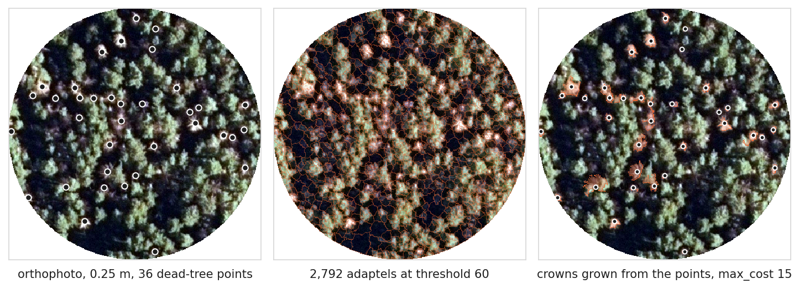

<h1></h1>

[](https://github.com/igorpawelec/geosegments/actions/workflows/pygeoadaptels-tests.yml)
[](https://github.com/igorpawelec/geosegments/actions/workflows/R-CMD-check.yaml)
[](https://github.com/igorpawelec/geosegments/actions/workflows/parity.yml)
[](https://github.com/igorpawelec/geosegments/actions/workflows/qgis-tests.yml)
[](https://github.com/igorpawelec/geosegments/actions/workflows/sigments-tests.yml)
[](LICENSE)

**Image segmentation algorithms for geospatial rasters: adaptive superpixels, seeded growing and a prototype with one dimensionless tolerance.**

A raster goes in; a segmentation comes out, as a label raster or as polygons. The repository holds two methods and the plugin that brings the first of them to QGIS:

| | Part | Latest | Install |
|---|---|---|---|
| Python | [`pygeoadaptels`](adaptels/python/) |  | `pip install --no-deps "git+https://github.com/igorpawelec/geosegments.git#subdirectory=adaptels/python"` |
| R | [`rgeoadaptels`](adaptels/r/) |  | `remotes::install_github("igorpawelec/geosegments", subdir = "adaptels/r")` |
| QGIS | [GeoAdaptels + GeoPalette plugin](qgis/) |  | `geoadaptels_palette-<version>.zip` from the [releases page](https://github.com/igorpawelec/geosegments/releases), then *Plugins → Manage and Install Plugins → Install from ZIP* |
| Python | [`sigments`](sigments/) | research prototype, not released | `pip install -e "sigments[io]"` from a clone (`[io]` adds rasterio and geopandas, which the command line needs) |

The two adaptels packages are bit-identical and are compared with each other whenever either changes ([parity workflow](.github/workflows/parity.yml)). The plugin carries `pygeoadaptels` from the same commit.

**Authors:** Igor Pawelec, University of Agriculture in Kraków. **License:** GPL-3.0-or-later.

## The problem it solves

Object-based analysis of an orthophoto starts by cutting the image into segments, and the usual superpixel methods ask how many. A fixed count imposes a grid on a scene that has no grid: the segment size that resolves a small crown is wasted on a stretch of shadow.

- **Adaptels** let the scene decide. A region grows from a seed until its internal colour distance passes a threshold; the pixels beyond it become seeds in turn. Where the image is textured the regions stay small, where it is homogeneous they grow large.
- **`grow_seeds`** is the inverse: when the objects are already known as points, every point grows into the region that looks like the pixel it sits on, within a tolerance, and everything unseeded stays unassigned.
- **SICLE** runs on the same kernel when a fixed number of superpixels is wanted.
- **sigments** asks whether one dimensionless parameter can do the job: the bands are put into units of the image's own pixel-to-pixel variability and a region is everything within `k` of those units from the colour of its seed. What was found, including what did not work, is in [sigments/README.md](sigments/README.md).



*A 100 × 100 m circular sample plot in a spruce stand at 0.25 m (`adaptels/python/test_data/SNP_21_2020_1.tif`), with 36 standing dead trees digitised as points. Middle: the plot partitioned into 2,792 adaptels at the default threshold of 60. Right: the crowns `grow_seeds` grows from the 36 points on the CIELAB version of the same scene. Read the two panels as a decision: partition the whole scene when the objects are unknown, grow from points when they are known. Made by `adaptels/python/www/figures.py`.*

## Quick start

Python ([details](adaptels/python/README.md)):

```python
from pygeoadaptels import create_adaptels

labels, n = create_adaptels("input.tif", "adaptels.tif", threshold=60.0)
```

R ([details](adaptels/r/README.md)):

```r
library(rgeoadaptels)

adaptels_raster("scene.tif", "adaptels.tif", threshold = 60)
```

QGIS ([details](qgis/README.md)): *Processing Toolbox → GeoAdaptels + GeoPalette*, six algorithms.

sigments ([details](sigments/README.md)):

```bash
python -m sigments ortho.tif labels.tif --k 9
```

## What is where

| Path | Content |
|---|---|
| [`adaptels/python/`](adaptels/python/) | `pygeoadaptels`: adaptels, SICLE and `grow_seeds`, with tests, examples and changelog |
| [`adaptels/r/`](adaptels/r/) | `rgeoadaptels`: the same kernel in R and C, with the tools that compare it with `pygeoadaptels` |
| [`qgis/`](qgis/) | the GeoAdaptels + GeoPalette plugin for QGIS and `build_zip.py`, which builds the installable zip |
| [`sigments/`](sigments/) | the sigments prototype: the package, its benchmarks in `bench/` and their results |
| [`.github/workflows/`](.github/workflows/) | one workflow per part and `parity`, each run only for the folders it covers |

## Releases

Each part is versioned and tagged on its own, and the tag carries the name of the part: `pygeoadaptels-vX.Y.Z`, `rgeoadaptels-vX.Y.Z`, `qgis-vX.Y.Z`. The tags up to `pygeoadaptels-v0.10.4`, `rgeoadaptels-v0.4.0` and `qgis-v0.5.5` were carried over, with the full history, from the repositories the parts used to live in: `pygeoadaptels`, `rgeoadaptels` and `qgis-geoadaptels-geopalette`. A `qgis-v` tag builds the plugin zip and attaches it to a release.

## Citation

The adaptels and their use for standing dead trees are described in:

> Pawelec, I., Hawryło, P., Netzel, P., & Socha, J. (2026). Evaluating superpixel algorithms for standing dead tree delineation using aerial orthoimagery. *International Journal of Applied Earth Observation and Geoinformation*, 147, 105180. https://doi.org/10.1016/j.jag.2026.105180

Each released part carries its own citation metadata: [adaptels/python/CITATION.cff](adaptels/python/CITATION.cff), [adaptels/r/CITATION.cff](adaptels/r/CITATION.cff) and [qgis/CITATION.cff](qgis/CITATION.cff).

## Licence

GNU General Public License v3.0 or later, see [LICENSE](LICENSE); it covers every part of the repository, the sigments prototype included. Copyright Igor Pawelec, University of Agriculture in Kraków.
